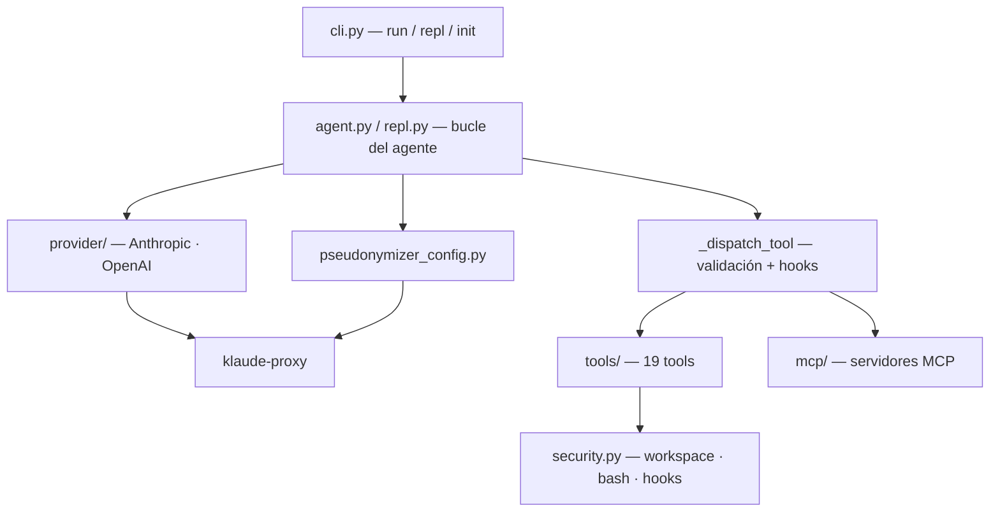

# 🤖 Klaus Code CLI

> **Agente de codificación agnóstico de proveedor.** Conecta cualquier modelo (Anthropic, OpenAI, local vía LiteLLM/Ollama) con tu código desde la terminal, con confirmaciones, límites de seguridad y seudonimización de datos.

[](https://github.com/Ka0s-Klaus/klaus-code-cli/actions/workflows/ci.yml)
[](https://www.python.org/)
[](LICENSE)

---

## 🤔 ¿Qué hago? ¿Cómo lo hago? ¿Y para qué lo hago?

**¿Qué hago:** Soy un agente de IA que lee, busca, edita y ejecuta en tu proyecto a partir de instrucciones en lenguaje natural, en una tarea (`klaus run`) o en una conversación (`klaus repl`).

**¿Cómo lo hago:** Envío tu petición y las herramientas disponibles a un modelo a través de **klaude-proxy** (o de cualquier API compatible con Anthropic/OpenAI). Ejecuto las herramientas que pide, pidiendo confirmación para escrituras y comandos, y devuelvo los resultados hasta completar la tarea.

**¿Para qué lo hago:** Para tener un asistente de código en la terminal que no te ata a un proveedor, que funciona con modelos locales y que protege tu entorno y tus datos: workspace confinado, confirmaciones y seudonimización antes de llegar a modelos externos.

---

## 🎯 Características principales

| Feature | Descripción |
|---|---|
| 🔌 **Multi-proveedor** | Formato Anthropic u OpenAI: klaude-proxy, Anthropic, OpenAI, LiteLLM, Ollama, vLLM… |
| 🧰 **19 tools integradas** | Ficheros, búsqueda, bash, git, web, imágenes, tareas, memoria y sub-agentes ([🔧 Tools](docs/tools.md)) |
| 💬 **REPL interactivo** | Sesiones persistentes, checkpoints, `/model`, comandos personalizados |
| 🔐 **Seguridad** | Workspace confinado, confirmaciones, denylist/allowlist de bash, hooks con confianza ([🔐 Security](docs/security.md)) |
| 🔒 **Seudonimización** | Registra rutas y usuario en klaude-proxy antes de hablar con modelos externos |
| 📋 **Plan mode** | `--plan` propone un plan y pide confirmación antes de actuar |
| 🧠 **Contexto** | `KLAUS.md` por proyecto, memorias persistentes y auto-compactación |
| 🪝 **Hooks** | Scripts Pre/PostToolUse, Stop y Notification |
| 🔧 **MCP** | Servidores Model Context Protocol como tools adicionales |
| ⚡ **Modos autónomos** | `--allow-writes`, `--allow-bash`, `--yolo` |

---

## 🚀 Instalación rápida

### Requisitos
- Python 3.11+
- Acceso a klaude-proxy o a una API compatible (Anthropic/OpenAI)

### Pasos

```bash
git clone https://github.com/Ka0s-Klaus/klaus-code-cli.git
cd klaus-code-cli
pip install -e .

klaus init                                        # crea ~/.klaus/config.yaml
export KLAUS_PROXY_URL="http://<host>:8080/v1"    # tu klaude-proxy
export KLAUS_API_KEY="sk-ant-..."                 # si tu proxy la requiere
klaus config show                                 # verificar
```

> ♻️ ¿Vienes de una versión anterior? `KLAUDE_*` y `~/.Klaus` siguen funcionando, con aviso. Ver [⚙️ Configuration](docs/configuration.md#-ubicación-del-fichero-de-config).

---

## 💡 Uso

### Una tarea

```bash
klaus run "Refactoriza parse_config en config.py para usar dataclasses"
klaus run "Añade tests para sessions.py" --plan     # plan previo + confirmación
klaus run "Formatea con ruff" --allow-bash          # bash sin confirmación
```

### Conversación (REPL)

```bash
klaus repl                          # sesión del proyecto actual (se reanuda)
klaus repl --session mi-feature     # sesión con nombre
klaus repl --model claude-opus-4-8  # otro modelo
klaus sessions list                 # sesiones guardadas
```

| Comando | Acción |
|---|---|
| `/help` | Ayuda (incluye tus comandos personalizados) |
| `/model [nombre]` | Ver o cambiar el modelo |
| `/tokens` | Consumo acumulado de la sesión |
| `/todos` | Lista de tareas de la sesión |
| `/memory list` · `/memory add <n> <txt>` | Memorias persistentes |
| `/checkpoint [nombre]` · `/checkpoints` | Guardar y listar checkpoints |
| `/history` · `/sessions` · `/clear` | Historial, sesiones, limpiar |
| `/exit` · `/quit` | Salir |

### Contexto del proyecto

Crea un `KLAUS.md` en la raíz con las convenciones del proyecto (o genera uno con `klaus init --scan`). Se inyecta en el system prompt de cada sesión.

---

## 🏗️ Arquitectura



**Stack:**
- CLI: Typer + Rich
- Configuración: Pydantic + YAML (`~/.klaus/config.yaml`)
- HTTP: httpx + tenacity (reintentos)
- MCP: SDK oficial `mcp`
- Tests: pytest + pytest-asyncio · Lint: ruff · Tipado: mypy

Detalle en [🏗️ Architecture](docs/architecture.md).

---

## 🧪 Tests

```bash
pip install -e ".[dev]"
ruff check . && mypy . && pytest tests/ -q
```

Los mismos checks que el CI (Python 3.11 / 3.12 / 3.13). Ver [🧪 Development](docs/development.md).

---

## 📚 Documentación

| Doc | Contenido |
|---|---|
| [📦 Installation](docs/installation.md) | Requisitos, instalación, configuración inicial |
| [💡 Usage](docs/usage.md) | Todos los comandos, flags y ejemplos |
| [⚙️ Configuration](docs/configuration.md) | Referencia completa de `~/.klaus/config.yaml` y variables `KLAUS_*` |
| [🔐 Security](docs/security.md) | Modelo de amenazas y configuración recomendada por entorno |
| [🔧 Tools](docs/tools.md) | Las tools integradas y sus confirmaciones |
| [🔌 MCP](docs/mcp.md) | Servidores MCP externos |
| [🏗️ Architecture](docs/architecture.md) | Módulos y flujo interno |
| [🧪 Development](docs/development.md) | Entorno local, CI y release |
| [📏 Evaluation](docs/evaluation.md) | Batería de tareas y `klaus eval` para medir el agente |
| [🗺️ Roadmap](docs/roadmap.md) | Propuesta de producto: agente de código soberano en 4 fases |

---

## 🤝 Contribuir

Todo cambio sigue el flujo **issue → rama → PR con aprobación humana**. Ver [🤝 CONTRIBUTING.md](CONTRIBUTING.md), que incluye la convención de nombres y el checklist del PR.

---

## 📄 Licencia

[MIT](LICENSE) © 2026 Ka0s
