# 🗺️ Roadmap — Agente de código soberano

> **Estado: aprobado** el 3 de noviembre de 2026 ([#69](https://github.com/Ka0s-Klaus/klaus-code-cli/issues/69)). Sustituye como dirección de producto al [roadmap de paridad con Claude Code](roadmap-feature-parity.md), cuyas fases 1-9 ya están completadas.

---

## 🤔 ¿Qué hago? ¿Cómo lo hago? ¿Y para qué lo hago?

**¿Qué hago:** Dejo de perseguir la paridad con Claude Code y convertir Klaus en **el agente de código soberano para clientes regulados**, en cuatro fases de noviembre de 2026 a septiembre de 2027.

**¿Cómo lo hago:** Con fases cerradas por **gates** comprobables, empezando por una batería de evaluación que permita medir la calidad del agente antes de invertir en nada más.

**¿Para qué lo hago:** La distancia real con un producto maduro está en robustez y calidad medida, no en funciones. Klaus tiene una ventaja propia: modelos locales, seudonimización y control del cliente. Esta propuesta la convierte en el producto.

> Supuesto de capacidad: un equipo de 2–3 personas a tiempo parcial. Con otra capacidad, las fechas se escalan; el orden se mantiene.

---

## 🎯 Posicionamiento

Klaus no debe competir como un Claude Code alternativo, sino como el agente que un cliente regulado **puede instalar y auditar dentro de su propio entorno**.

| | Claude Code y similares | Klaus Code CLI (propuesta) |
|---|---|---|
| Comprador | Desarrollador o equipo | Cliente regulado (banca, sector público, salud) y su equipo de seguridad |
| Modelos | Optimizado para un proveedor | Cualquiera: on-premise, local o externo vía klaude-proxy |
| Datos | Código y prompts hacia la API del proveedor | Seudonimización antes de salir; modo 100 % local |
| Control | Configuración del usuario | Política de la organización, auditable |
| Ventaja | Calidad general, ecosistema | Soberanía, cumplimiento, despliegue en el cliente |

**Por qué no la paridad:** el [roadmap de paridad](roadmap-feature-parity.md) ya está casi cumplido en funciones, pero la distancia real está en robustez y calidad, que se ganan con medición y uso, no con más funciones. Competir ahí contra un producto con muchos más recursos es una carrera que no se gana.

---

## 📍 Punto de partida (tras la revisión FDE, noviembre de 2026)

| Área | Estado | Evidencia |
|---|---|---|
| Funciones | ✅ Completo para una alfa | 19 tools, MCP, hooks, sub-agentes, memoria, sesiones |
| CI y tests | ✅ Verde | 269 tests; antes de [#54](https://github.com/Ka0s-Klaus/klaus-code-cli/issues/54) estaba roto durante semanas |
| Seguridad | 🟡 Base sólida | Workspace, confirmaciones, hooks con confianza, MCP con confirmación ([#56](https://github.com/Ka0s-Klaus/klaus-code-cli/issues/56), [#61](https://github.com/Ka0s-Klaus/klaus-code-cli/issues/61)) |
| Privacidad | 🟡 Base sólida | Seudonimizador en todas las vías; `required` opcional ([#55](https://github.com/Ka0s-Klaus/klaus-code-cli/issues/55)) |
| Calidad del agente | 🔴 Sin medir | No hay batería de evaluación; no se sabe qué modelos funcionan bien |
| Proceso | 🟡 Definido, sin forzar | [`CONTRIBUTING.md`](../CONTRIBUTING.md) existe; la protección de `main` no se activa de momento (decisión del 3/11/2026) |
| Release | 🔴 Nunca publicado | Sin tags; `LICENSE` añadido en [#69](https://github.com/Ka0s-Klaus/klaus-code-cli/issues/69) |
| Despliegue en cliente | 🔴 Sin empezar | Solo `pip install -e .`; sin modo offline ni configuración centralizada |

---

## 🏗️ Roadmap de un vistazo

```mermaid
flowchart LR
    F0["<b>Fase 0 · Cimientos</b><br/>nov–dic 2026<br/>Evaluación · proceso · v0.16"]
    G0{{"Gate 0<br/>baseline medido<br/>en 2 modelos"}}
    F1["<b>Fase 1 · Confianza</b><br/>ene–mar 2027<br/>Auditoría · sandbox · políticas"]
    G1{{"Gate 1<br/>revisión de seguridad<br/>externa sin bloqueantes"}}
    F2["<b>Fase 2 · Modelos</b><br/>abr–jun 2027<br/>Ajuste por familia · matriz certificada"]
    G2{{"Gate 2<br/>≥1 modelo local<br/>certificado"}}
    F3["<b>Fase 3 · Despliegue</b><br/>jul–sep 2027<br/>Instalación offline · piloto"]
    G3{{"Gate 3<br/>piloto en producción<br/>con 1 cliente"}}
    F0 --> G0 --> F1 --> G1 --> F2 --> G2 --> F3 --> G3
```

Cada fase termina en un **gate** con un criterio comprobable. Sin gate superado, no se empieza la fase siguiente.

---

## 0️⃣ Fase 0 — Cimientos (noviembre–diciembre de 2026)

**Objetivo:** poder medir la calidad del agente y publicar una primera versión con un proceso que no se rompa.

1. **Batería de evaluación** *(el entregable principal)*: primera versión con 12 tareas en [#71](https://github.com/Ka0s-Klaus/klaus-code-cli/issues/71) → [📏 Evaluation](evaluation.md)
    - 30–50 tareas reales y reproducibles: corregir un bug, añadir un test, refactorizar, navegar un repo desconocido, tareas con trampas de seguridad.
    - Cada tarea en un repo fijado, con un comprobador automático (tests que deben pasar, o un diff esperado).
    - Un comando `klaus eval --model <m>` que ejecuta la batería y saca una tabla: tasa de éxito, turnos, tokens, coste y tiempo.
    - Baseline en Claude Opus 5.5, Sonnet 5.5 y Haiku 5.5 (vía klaude-proxy) y qwen3:30b en local (Ollama): [procedimiento](evaluation.md#-baseline-gate-0-del-roadmap).
2. **Proceso**
    - La protección de `main` **no se activa de momento**: el flujo issue → rama → PR se sigue por convención (`CONTRIBUTING.md`).
    - La batería de evaluación se ejecuta como job semanal y en los PRs que toquen `agent.py`, `tools/` o los prompts.
3. **Primera release `v0.16.0`**
    - ~~Fichero `LICENSE`~~ ✅ MIT, © Ka0s.
    - Tag y publicación por el workflow existente, que ya verifica que el tag coincide con la versión.
4. **Limpieza:** implementar `--mcp-config` ([#70](https://github.com/Ka0s-Klaus/klaus-code-cli/issues/70)); que `klaus init` ofrezca perfiles (`dev`, `cliente`, `ci`) basados en [🔐 Security](security.md#-configuración-recomendada-por-entorno).

**Gate 0:** baseline publicado en 2 modelos y `v0.16.0` instalable.

---

## 1️⃣ Fase 1 — Confianza (enero–marzo de 2027)

**Objetivo:** que el equipo de seguridad de un cliente pueda aprobar Klaus.

1. **Registro de auditoría:** cada tool call (quién, qué, cuándo, con qué argumentos, resultado, aprobado por quién) en JSONL firmado o encadenado por hash, exportable a SIEM.
2. **Sandbox para `run_bash`:** ejecución opcional en contenedor (Docker/Podman), con el proyecto montado y sin red por defecto. Es lo que cierra la limitación "bash no está confinado".
3. **Política de organización:** un fichero de política (`/etc/klaus/policy.yaml` o una URL firmada) que el usuario no puede relajar: modelos permitidos, `pseudonymizer.required`, `outside_workspace: deny`, servidores MCP permitidos.
4. **Seudonimización ampliada:** además de rutas y usuario, detectar secretos (claves, tokens) y datos personales configurables antes de enviar el contexto.
5. **Cadena de suministro:** SBOM en cada release, dependencias fijadas y firma de artefactos.
6. **Documentación para el CISO:** modelo de amenazas, flujo de datos, qué sale de la máquina y cuándo.

**Gate 1:** revisión de seguridad externa (o del equipo de seguridad de un cliente candidato) sin hallazgos bloqueantes.

---

## 2️⃣ Fase 2 — Modelos (abril–junio de 2027)

**Objetivo:** saber, con datos, qué modelos funcionan con Klaus y hacer que funcionen mejor.

1. **Matriz de modelos certificados:** cada modelo soportado pasa la batería con un umbral mínimo; se publica la tabla (éxito, coste y latencia por tarea).
2. **Ajuste por familia de modelo:** prompts de sistema, descripciones de tools y formato de los resultados adaptados a cada familia (Claude, GPT, Qwen, Llama, Mistral…). Se mide con la batería y se mantiene solo lo que mejora.
3. **Robustez del tool-calling:** reparar JSON mal formado, reintentos guiados y degradación controlada en modelos locales pequeños.
4. **Coste y latencia:** caché de prompts donde el proveedor lo soporte; compactación con resumen en lugar de ventana deslizante.
5. **Guía de dimensionamiento:** qué hardware necesita cada modelo local certificado.

**Gate 2:** al menos 1 modelo local certificado con una tasa de éxito ≥ 70 % de la del mejor modelo externo en la batería.

---

## 3️⃣ Fase 3 — Despliegue (julio–septiembre de 2027)

**Objetivo:** instalar Klaus en un cliente real y que lo use su equipo.

1. **Instalación sin internet:** paquete autocontenido (pipx/zipapp o imagen de contenedor) e instalación desde un mirror interno.
2. **Configuración centralizada:** política y configuración distribuidas por la organización, no editadas a mano por cada usuario.
3. **Observabilidad:** métricas OpenTelemetry (uso, errores, coste por equipo) sin enviar el contenido del código.
4. **Onboarding:** guía de despliegue para el equipo del cliente, runbook de soporte y formación de 1 día.
5. **Piloto:** 1 cliente, 1 equipo de 5–10 desarrolladores, 6–8 semanas, con criterios de éxito acordados al empezar.

**Gate 3:** piloto en producción con el cliente y decisión de seguir (o no) con datos de uso reales.

---

## 📊 Métricas de éxito

| Métrica | Hoy | Objetivo | Fase |
|---|---|---|---|
| Tasa de éxito en la batería (mejor modelo externo) | Sin medir | Baseline + 15 puntos | 0 → 2 |
| Modelos locales certificados | 0 | ≥ 1 | 2 |
| Hallazgos de seguridad bloqueantes en revisión externa | Sin revisar | 0 | 1 |
| Tool calls con registro de auditoría | 0 % | 100 % | 1 |
| Releases publicadas | 0 | Mensual desde v0.16 | 0 → 3 |
| Commits directos a `main` | Posibles | 0 (por convención, sin protección técnica) | 0 |
| Clientes en piloto | 0 | 1 | 3 |

---

## 🚫 Fuera de alcance (por decisión explícita)

- Perseguir funciones de Claude Code que no sirvan al posicionamiento de soberanía.
- Plugins de IDE e interfaz gráfica (posible después de la Fase 3, si el piloto lo pide).
- Entrenar o ajustar modelos propios.

---

## ⚠️ Riesgos y mitigaciones

| Riesgo | Impacto | Mitigación |
|---|---|---|
| Los modelos locales no alcanzan una calidad útil | Alto: invalida la propuesta "100 % local" | Medirlo en la Fase 0 antes de invertir más; posicionar el modo seudonimizado con un modelo externo como opción principal si hace falta |
| Capacidad del equipo insuficiente | Alto: fechas | Fases con gates: se recorta alcance, no calidad; la Fase 0 es imprescindible |
| La batería de evaluación no representa el uso real | Medio | Tareas sacadas de repos y tickets reales de clientes candidatos; revisarla en cada gate |
| La seudonimización da una falsa sensación de seguridad | Alto: reputación | Documentar sus límites con claridad; `required: true` y modo local en los perfiles de cliente |
| klaude-proxy evoluciona por separado | Medio | Contrato versionado entre Klaus y el proxy, con tests de integración |
| No aparece un cliente para el piloto | Medio | Buscar el cliente candidato durante la Fase 1 y usar su revisión de seguridad como Gate 1 |

---

## ✅ Decisiones

Tomadas el 3 de noviembre de 2026 ([#69](https://github.com/Ka0s-Klaus/klaus-code-cli/issues/69)):

| Decisión | Resultado |
|---|---|
| Cambio de posicionamiento | ✅ Aprobado |
| Protección de `main` | ⏸️ No se activa de momento |
| Titular del copyright (`LICENSE`) | Ka0s |
| `--mcp-config` | ✅ Se implementa ([#70](https://github.com/Ka0s-Klaus/klaus-code-cli/issues/70)) |
| Modelos del baseline (4/11/2026, [#75](https://github.com/Ka0s-Klaus/klaus-code-cli/issues/75)) | Externos: Claude Opus 5.5, Sonnet 5.5 y Haiku 5.5 · Local: qwen3:30b (Ollama) |

Pendientes:

- [ ] Confirmar la capacidad del equipo para la Fase 0
- [ ] API key de la Claude Console para el baseline (una suscripción Pro no da acceso a la API)
- [ ] Cliente candidato para la revisión de seguridad (Gate 1) y el piloto (Fase 3)

---

## 📚 Documentación relacionada

| Doc | Contenido |
|---|---|
| [🗺️ Roadmap de paridad](roadmap-feature-parity.md) | Histórico: fases 1-9 de paridad con Claude Code (completadas en [#46](https://github.com/Ka0s-Klaus/klaus-code-cli/pull/46)) |
| [🔐 Security](security.md) | Modelo de amenazas y configuración por entorno (base de la Fase 1) |
| [🧪 Development](development.md) | CI y proceso de release (base de la Fase 0) |
